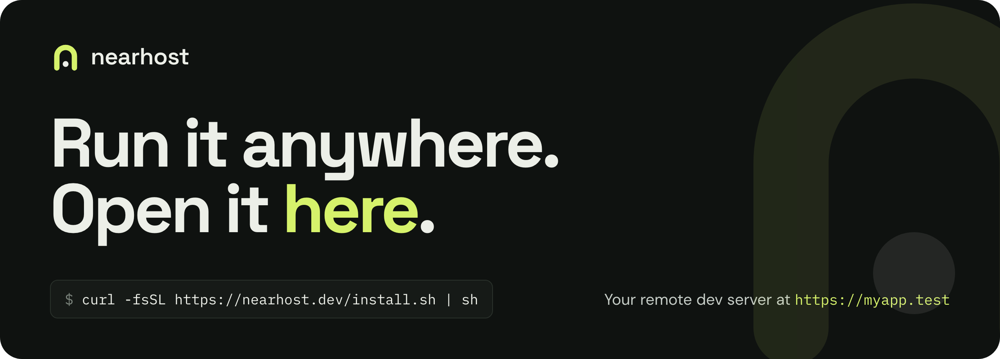

<p align="center">
  <a href="https://nearhost.dev">
    
  </a>
</p>

**Nearhost** opens a dev server that runs on another machine at a trusted `https://name.test` address on your laptop. It uses the SSH access you already have and installs nothing on the server.

You write code on a laptop and run it somewhere else: a desktop under the desk, a home server, a VPS. Without Nearhost that means an `ssh -L` flag for every port, a certificate warning on every load, and hot reload that never connects. With it, each project has a name, a certificate your browser trusts, and forwards that reconnect on their own.

## Install

```sh
curl -fsSL https://nearhost.dev/install.sh | sh
```

Or with Homebrew or npm:

```sh
brew install nearhost/tap/nearhost
npx @nearhost/cli
```

Then run `nearhost`, add a server, add a project, and press `o` to open it. The [quick start](https://nearhost.dev/docs/getting-started/introduction/) covers each step.

## What you get

- **One address per project.** `https://myapp.test` today, tomorrow and after a reboot.
- **Real HTTPS.** Secure cookies, OAuth callbacks and service workers behave as they do in production.
- **Hot reload and WebSockets.** They travel through the same SSH connection.
- **Nothing on the server.** No agent, no config changes, no open ports. If `ssh <host>` works, Nearhost works.
- **Any stack.** Nearhost routes ports. It reads Compose files and Vite configs to propose them, and you can enter them by hand for anything else.
- **Nothing leaves your machines.** No relay, no account and no public URL.

## How it works

1. A local proxy answers `https://myapp.test` with a certificate from a certificate authority created on your machine.
2. OpenSSH carries the request to `localhost` on the remote machine, using your own `ssh_config`.
3. Dev server ports that pages load from `localhost` are forwarded to the same port number on your laptop.

Read more in the [docs](https://nearhost.dev/docs/).

## Repositories

| Repository | What it holds |
| --- | --- |
| [nearhost](https://github.com/nearhost/nearhost) | The terminal app and command line tool, written in Go. Issues and releases live here. |
| [landing](https://github.com/nearhost/landing) | The website and documentation at [nearhost.dev](https://nearhost.dev). |
| [homebrew-tap](https://github.com/nearhost/homebrew-tap) | The Homebrew formula. |

Nearhost is open source under the MIT licence, for macOS and Linux.
